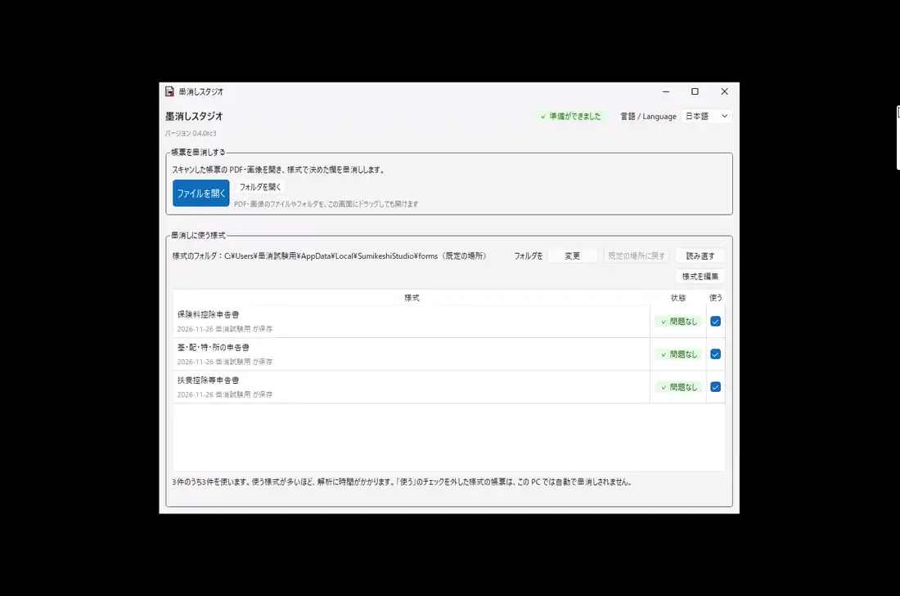

# Sumikeshi Studio (墨消しスタジオ)



The Japanese README is [README.md](README.md).

Sumikeshi Studio is a tool that, using the settings of a form registered in advance, automatically redacts (blacks out) fields on sheets filled in on that form. From scanned PDFs or photographs of sheets, it automatically detects the fields that the form specifies for redaction, and exports PDFs in which those fields are redacted. It works without an Internet connection.

## Features

- **Specific fields of registered forms are redacted automatically**: Register a document without entries as a form and define the fields to redact, and when you open a sheet of that form, the tool finds the fields automatically and redacts them.
- **Variations of a form are also identified**: Sheets whose fields differ slightly in size or position from the sample image are also identified as the same form and redacted.
- **Supports both scanned PDFs and images taken with a smartphone**: PDF and image files (JPEG, PNG, TIFF, and BMP) can be opened. Images in which the sheet appears skewed can also be handled.
- **Multiple forms in one go**: Open PDFs that mix different types of documents, or multiple files and folders at once, and the tool identifies the form of each page and redacts it.
- **Redaction areas can be corrected**: The automatically determined redaction areas can be corrected on the screen. You can move frames, resize them, add areas, and switch redaction on or off for each field. Pages that the tool cannot fully decide automatically are marked "⚠ Review".
- **No text data left in the PDF**: The output is an image-only PDF. The text data of the original PDF file is not kept.
- **No external communication**: Everything runs only on the PC.

## Requirements

| Item | Details |
|---|---|
| OS | Operation has been checked on Windows 11 Pro (64-bit). Operation on each version of Windows has not been checked. |
| Internet connection | No Internet connection is required. |
| Python | The tool runs on Python. The distribution package includes Python 3.14. |
| CPU and memory | If the CPU and memory have enough capacity (4 or more logical CPUs and 4 GB or more of free memory), the tool works in parallel. |

## Installation

### Installing from the distribution package

The distribution package is a ZIP that contains Python, the libraries, and the tool itself (for how to build it, see "[Development](#development)"). The latest package is on the [Releases page](https://github.com/hohm-sdx/sumikeshi-studio/releases).

> [!IMPORTANT]
> If you downloaded the ZIP from the Internet (for example, from the Releases page), before extracting it, right-click the ZIP → "Properties", and if the "General" tab shows a security warning such as "This file came from another computer", select the "Unblock" check box → "OK". Windows marks a downloaded ZIP as coming from the Internet, and if you extract the ZIP with this mark, Smart App Control may block `setup.bat`. If the "General" tab of the ZIP file's properties shows no warning such as "This file came from another computer", this step is not needed. If `setup.bat` is blocked, delete the extracted folder, select "Unblock" for the ZIP, and then extract it again.

1. Extract all files from the ZIP (anywhere is fine, but installation for all users cannot be done from a network folder).
2. Double-click `setup.bat` in the extracted `sumikeshi-studio` folder, and choose the type of installation (pressing Enter alone chooses 1). 1 (Just for me) moves the extracted folder to `%LOCALAPPDATA%\Programs\SumikeshiStudio` without administrator rights (on another drive, it copies the folder and deletes the original). 2 (All users of this PC) copies it to `C:\Program Files\SumikeshiStudio` with administrator rights. Both register the tool in "Installed apps" in Windows and create shortcuts on the Start menu and the desktop. They are named "墨消しスタジオ" on Japanese Windows and "Sumikeshi Studio" on other Windows. The installation messages are shown in the language selected in the tool (if none is selected, in the Windows display language).
3. If there is no forms folder or no forms are registered, you are asked whether to add the National Tax Agency forms (the three declarations) as samples (for just-for-me installation, during the installation; for installation for all users, the first time each user starts the tool). The forms added here can be deleted later (delete them with "Edit forms" on the start screen).
4. Start the tool from the shortcut on the Start menu or the desktop.

To update to a new version, extract the new ZIP, run `setup.bat`, and choose the same type of installation as before (Just for me / All users of this PC). If you choose a different type, setup stops without changing anything. To uninstall, use "Installed apps" or `uninstall.bat` in the installed folder. Instructions for users, such as what uninstalling deletes and the forms folder when several users use the tool, are in the README in the ZIP (Japanese version [windows/README-ja.txt](windows/README-ja.txt), English version [windows/README-en.txt](windows/README-en.txt)).

## Usage

1. Start the tool from the shortcut on the Start menu or the desktop, and the start screen appears. It shows the forms folder and the list of forms used for redaction on this PC.
2. Click "Open files" or "Open folder" and select PDF or image files or folders (you can also drag them onto the start screen). The redaction screen opens, analyzes all pages, and shows the fields to redact with orange frames.
3. Check the redaction areas while moving through the pages in the list on the left, and correct them if needed. Clicking a field switches between redacting it and not redacting it. Dragging on an empty spot adds an area, and dragging inside or at a corner of a frame moves or resizes it. For pages with the "⚠ Review" or "⚠ Orientation" label, read the reason shown in the banner above the page, and check them with particular care. The "How to use" button shows the list of operations.
4. Click "Export redacted PDF" (Ctrl+S) and select the output folder. One "original name_redacted.pdf" is created for each input file.

To add or edit forms, click "Edit forms" on the start screen.

### Exporting from the command line (without the screen)

You can also analyze files and export redacted PDFs without showing the screen (example: `sumikeshi.bat C:\scan --out C:\out`). Because nobody checks the pages on the screen, after the export, check the pages that need checking, which are printed to standard output and written to the work log. `--help` shows the list of arguments.

## Development

Development and automated tests are done on Linux (Debian 13). The environment is created with uv (0.13.6; for how to install it, see the [uv documentation](https://docs.astral.sh/uv/getting-started/installation/)). An Internet connection is required to create the environment and to build the distribution package.

```bash
uv sync --locked                                       # Create the development environment (Python 3.14 and the libraries are installed in .venv)
uv run python -m sumikeshi_studio                      # Start the tool
uv run pytest -n 4 -m "regression or not regression"   # Run all tests
uv run ruff format src tests tools && uv run ruff check src tests tools  # Format and check the code
uv run python tools/make_dist.py                       # Build the distribution package (the ZIP in dist/)
```

- The GUI tests need the following libraries that Qt loads (Debian and Ubuntu package names): libgl1, libglx0, libglvnd0, libegl1, libopengl0, libxkbcommon0, libdbus-1-3, libfreetype6, libfontconfig1. Without them, the GUI tests are skipped instead of failing (check with `-rs`).
- Building the distribution package requires osslsigncode (a tool that checks the signatures of Windows programs), to check the digital signatures of the .exe, .dll, and .pyd files in the package.
- The licenses of the dependencies and the notices required for distribution are in "[License](#license)".

## Folder structure

| Path | Contents |
|---|---|
| `src/sumikeshi_studio/` | The tool itself |
| `src/sumikeshi_studio/bundled_forms/` | The three sample forms included in the distribution package (the sample images made from the National Tax Agency's published forms, and the form information `.json`). If the forms folder has no forms, you are asked whether to add them during the installation (for installation for all users, when each user starts the tool for the first time) |
| `src/sumikeshi_studio/icons/` | The original drawings (SVG) of the tool icon, and the icon file (`.ico`, used by the shortcuts and the app list) and the PNG images for the windows that are made from them |
| `tools/make_templates.py` | Script that builds the sample forms |
| `tools/make_icons.py` | Script that builds the icon file and the PNG images from the original SVG drawings (`tests/test_icons.py` checks that the built files match the drawings) |
| `tools/make_dist.py` | Script that builds the distribution package |
| `tools/fetch_sources.py` | Script that downloads the source archives of the LGPL components in the package (Qt and GEOS) and checks their SHA-256 (the archives are attached to the Releases page) |
| `tools/make_qt_licenses.py` | Script that creates, from the Qt source (qtbase), the license texts of the third-party components contained in the Qt DLLs kept in the package (`licenses/qt/`) and the corresponding rows of the mapping table |
| `tools/make_test_pdfs.py` | Script that creates PDFs used for checks in the tests (5 of the `tests/data/試験_*.pdf` files) |
| `tests/` | Automated tests |
| `tests/data/` | Test data (images rendered from the published forms, images with fictitious numbers and other entries written on them, and PDFs used for checks. All numbers, names, and company names are fictitious. `tests/data/README.md`) |
| `windows/` | Installation files and instructions included in the distribution package |
| `dist/` | Output location of the distribution package (not tracked by git) |
| `LICENSE` | License of this tool (the full text of the AGPL-3.0) |
| `LICENSE-EXCEPTION.txt` | Additional permission under section 7 of the AGPL-3.0 |
| `licenses/` | Full texts of the licenses of the dependencies, and the mapping table, included in the distribution package (see the "License" section) |
| `pyproject.toml`, `uv.lock`, `.python-version` | Dependent libraries and their versions |
| `samples/` | Forms published by the National Tax Agency (without entries). The sources of the PDFs directly in this folder are in the "Source of the National Tax Agency forms" section |
| `samples/2025bun_01.pdf` | 扶養控除等（異動）申告書, 令和7年分 (2025) |
| `samples/2026bun_01.pdf` | 扶養控除等（異動）申告書, 令和8年分 (2026) |
| `samples/2027bun_01.pdf` | 扶養控除等（異動）申告書, 令和9年分 (2027) |
| `samples/2026bun_04.pdf` | 保険料控除申告書, 令和8年分 (2026) |
| `samples/2026bun_06.pdf` | 基礎控除申告書 兼 配偶者控除等申告書 兼 特定親族特別控除申告書 兼 所得金額調整控除申告書, 令和8年分 (2026) |
| `samples/2026bun_08.pdf` | 従たる給与についての扶養控除等（異動）申告書, 令和8年分 (2026) |

## Source of the National Tax Agency forms

The PDFs directly in `samples/` are forms published on the National Tax Agency website (without entries), as they are. The sample images of the three sample forms included in the distribution package (the PNG files in `src/sumikeshi_studio/bundled_forms/`) and the test images (`公開様式_*` and `架空記入_*` in `tests/data/`) were created by Hideki Ohmura by processing forms published on the National Tax Agency website. They were not created by the National Tax Agency.

These files (the forms published by the National Tax Agency and the files created by processing them) are not covered by the AGPL-3.0; they can be used under the [terms of use](https://www.nta.go.jp/chuijiko/copy.htm) of the National Tax Agency website ([Public Data License (Version 1.0)](https://www.digital.go.jp/resources/open_data/public_data_license_v1.0)).

Source: National Tax Agency website. The published forms (PDF) used are the following.

- [2025bun_01.pdf](https://www.nta.go.jp/taxes/tetsuzuki/shinsei/annai/gensen/pdf/2025bun_01.pdf) (扶養控除等（異動）申告書, 令和7年分 (2025))
- [2026bun_01.pdf](https://www.nta.go.jp/taxes/tetsuzuki/shinsei/annai/gensen/pdf/2026bun_01.pdf) (扶養控除等（異動）申告書, 令和8年分 (2026))
- [2027bun_01.pdf](https://www.nta.go.jp/taxes/tetsuzuki/shinsei/annai/gensen/pdf/2027bun_01.pdf) (扶養控除等（異動）申告書, 令和9年分 (2027))
- [2026bun_04.pdf](https://www.nta.go.jp/taxes/tetsuzuki/shinsei/annai/gensen/pdf/2026bun_04.pdf) (保険料控除申告書, 令和8年分 (2026))
- [2026bun_06.pdf](https://www.nta.go.jp/taxes/tetsuzuki/shinsei/annai/gensen/pdf/2026bun_06.pdf) (基礎控除申告書 兼 配偶者控除等申告書 兼 特定親族特別控除申告書 兼 所得金額調整控除申告書, 令和8年分 (2026))
- [2026bun_08.pdf](https://www.nta.go.jp/taxes/tetsuzuki/shinsei/annai/gensen/pdf/2026bun_08.pdf) (従たる給与についての扶養控除等（異動）申告書, 令和8年分 (2026))
- [2027bun_09.pdf](https://www.nta.go.jp/taxes/tetsuzuki/shinsei/annai/gensen/pdf/2027bun_09.pdf) (公的年金等の受給者の扶養親族等申告書, 令和9年分 (2027); used only for the images in `tests/data/`)

## Contributions and contact

- External code contributions (pull requests) are not accepted.
- Support requests, usage questions, and bug reports are not accepted. Only private vulnerability reports through GitHub are accepted. How to report is described in [SECURITY.md](SECURITY.md).

## License

Copyright (C) 2026 Hideki Ohmura

This tool is distributed under the GNU Affero General Public License 3.0 only (AGPL-3.0-only). The full text is in [LICENSE](LICENSE). There is an additional permission under section 7 of the AGPL-3.0, which permits distributing this tool combined with the Microsoft Visual C++ Runtime or with OpenCV including Intel IPP ICV ([LICENSE-EXCEPTION.txt](LICENSE-EXCEPTION.txt)). In the distribution package, the same full text and the additional permission are in `licenses\sumikeshi-studio\`.

This tool comes with no warranty. To the extent permitted by applicable law, the author provides no warranty for this tool and is not liable for any damages arising from the use of this tool (sections 15 and 16 of the AGPL-3.0).

The full texts of the licenses of the dependencies included in the distribution package, and the list of the version, the license, and the location of the full text for each dependency, are in `licenses\` of the package (the list is `licenses\index.txt`). When the package is built, `tools/make_dist.py` creates them by copying the license files in the distributions of the dependencies and the full texts in `licenses/` of the repository. `licenses/` in the repository holds the full texts that the dependencies do not include themselves (GPL-3.0, LGPL-3.0, Apache-2.0, and the license texts of the Qt components included in the package), and a mapping table that lists what each full text applies to (`licenses/targets.tsv`). The license texts of the Qt components and their rows in the mapping table are created by `tools/make_qt_licenses.py` from `qt_attribution.json` in the Qt source.

Notices required for distribution:

- Qt for Python (PySide6 and shiboken6 6.12.0) is used for the user interface components under the GNU LGPL 3.0. The LGPL 3.0 is the GPL 3.0 supplemented by additional permissions (at its beginning: "incorporates the terms and conditions of version 3 of the GNU General Public License, supplemented by the additional permissions listed below"), and section 4 b ("Accompany the Combined Work with a copy of the GNU GPL and this license document.") requires that the full texts of the GPL 3.0 and the LGPL 3.0 accompany a work combined with the library. Therefore, the full texts (the original texts from gnu.org) are included in `licenses\GPL-3.0.txt` and `licenses\LGPL-3.0.txt` of the package, and the distribution README (Japanese and English versions) states this and where the full texts are. `LicenseRef-Qt-Commercial.txt`, which is included in its distribution, is kept as it is, but Qt is not used under a commercial license. The license texts of the third-party components contained in the Qt DLLs are in `licenses\qt\` of the package. The Qt source (pyside-setup for PySide6 and shiboken6, and qtbase of Qt) is placed on the Releases page of the public repository for the same version as the package (downloaded with `tools/fetch_sources.py`, with the SHA-256 checked).
- GEOS: shapely, the geometry library used by RapidOCR, includes GEOS 3.14.1, which is used under the GNU LGPL 2.1. The license text is in the shapely entry in `licenses\` of the package (the list is `licenses\index.txt`). Like the Qt source, the GEOS source is placed on the Releases page of the public repository for the same version as the package.
- FreeType: PDFium (pypdfium2), Pillow (`PIL\_imagingft`), and Qt (Qt6Gui) each include FreeType 2.14.3. The FreeType license ("2. Redistribution" of The FreeType Project License) requires, for distribution in binary form, that the documentation of the distribution state that it is based in part on the work of the FreeType Team. Therefore, the distribution README (`README-ja.txt` and `README-en.txt`) and this README contain the following sentence, which the license gives as an example. Following the license's instruction "Please replace `<year>` with the value from the FreeType version you actually use.", `<year>` is set to the years in the copyright notice of the FreeType 2.14.3 source ("Copyright (C) 1996-2026").
  - Portions of this software are copyright © 1996-2026 The FreeType Project (www.freetype.org). All rights reserved.
- The pypdfium2 distribution is not the one from PyPI; it was built by this project from the source distribution of pypdfium2 5.14.0 and the PDFium of chromium/8138 from pdfium-binaries (`tools/build_pypdfium2.py`; the built files are placed in `wheels/`, and their SHA-256 is written in `uv.lock`). This is because the PDFium (156.0.8076) in pypdfium2 5.14.0 on PyPI lacks 5 vulnerability fixes. The Python part is the same as 5.14.0 on PyPI; the differences are the PDFium component, its function definitions (`pypdfium2_raw\bindings.py`), and the license texts.
- The OCR models bundled with RapidOCR are converted from PaddleOCR (Baidu) models and are distributed under Apache-2.0 (`licenses\rapidocr\MODEL_LICENSES.md` in the package).
- Visual C++ runtime: The package contains DLLs of the Microsoft Visual C++ Runtime. All of them come from the distributions of components of the package (Python and the libraries), and the files, their locations, and which distribution each came from (and, for the files copied by `tools/make_dist.py`, where they were copied from) are listed in `licenses\index.txt` of the package. Microsoft's terms are in `licenses\Microsoft-Visual-C++-Runtime.txt` of the package (the English text and a Japanese translation; the English text prevails). The package is arranged so that its users are deemed to have agreed to those terms (the installation does not show a screen asking for consent).
