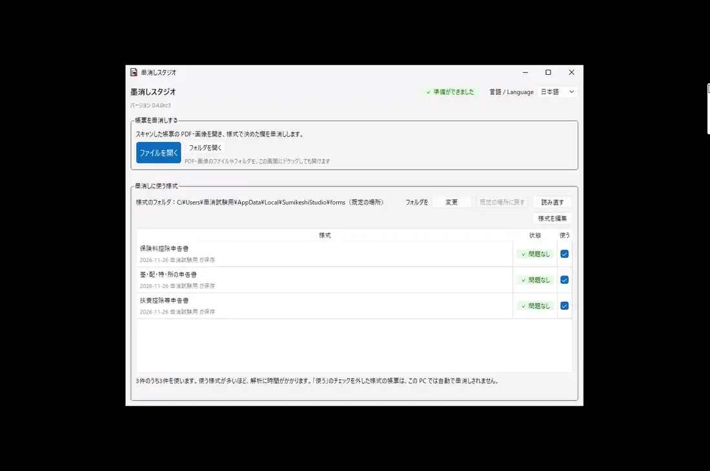

# 墨消しスタジオ（Sumikeshi Studio）



（画面と導入の文は日本語と英語の2つです。英語版の README は [README.en.md](README.en.md) です）

事前に登録しておいた様式の設定により、その様式で記入された用紙の欄を自動で墨消し（黒塗り）するツールです。スキャンした PDF あるいは用紙を撮影した写真から、様式で決めた墨消しの対象の欄を自動で検出し、その欄を墨消しした PDF を出力します。インターネットに接続せずに動作します。

## 特徴

- **様式を登録すれば、欄を自動で墨消し**：記入のない帳票を様式として登録し、墨消しする欄を決めておくと、その様式の用紙を開いたときに欄を自動で見つけて墨消しします。欄の中身は読みません。
- **国税庁の申告書のサンプル付き**：扶養控除等申告書・保険料控除申告書・基・配・特・所の申告書の3つを、個人番号欄を墨消しする様式として入れられます。
- **スキャンした PDF も、撮影した写真も**：PDF と画像（JPEG・PNG・TIFF・BMP）を開けます。傾いた写真や、給与ソフトが印字した申告書のように欄の位置が少し違う用紙も扱えます。
- **画面で確かめてから出力**：自動で決めた範囲を画面で確かめ、欄ごとに墨消しする・しないを切り替えたり、範囲を足したりできます。自動で判断しきれないページには「⚠ 要確認」が付きます。
- **文字のデータを残さない PDF**：出力は画像だけの PDF です。元のファイルの文字のデータ（スキャナーの OCR が付けた透明な文字など）は引き継ぎません。
- **外部に通信しない**：すべて PC の中だけで動作します。
- **様式を共有できる**：様式のフォルダを共有フォルダにすれば、全員が同じ様式を使えます。

## 動作環境

| 項目 | 内容 |
|---|---|
| OS | Windows（64ビット）。配布用パッケージは Windows 64ビット用に作ります。Windows のバージョンごとの動作は確かめていません |
| 管理者権限 | 自分だけの導入と起動には要りません。すべてのユーザー向けの導入には要ります |
| インターネット | 配布用パッケージから導入するときと、使うときは要りません。開発の環境を作るときと、配布用パッケージを作るときは要ります |
| Python | 配布用パッケージには Python 3.14 が入っています。開発の環境では、uv が Python 3.14 を入れます。onnxruntime に Python 3.15 用の配布物がないため（2026-10-29 時点の最新バージョン 1.31.1 で 3.14 まで）、3.15 では動きません |
| CPU とメモリ | 論理 CPU が4つ以上で、空きメモリが4GB以上なら、解析のプロセスを2つにして2ページを同時に解析します。そうでなければ1つにします |
| 開発の環境 | 開発と自動テストは Linux で行っています（「[開発の環境](#開発の環境)」）。使う PC は Windows を前提とします |

## 導入

### 配布用パッケージから導入する（インターネットは要らない）

配布用パッケージは、Python・ライブラリ・ツール本体を入れた ZIP です（作り方は「[配布用パッケージを作る](#配布用パッケージを作る)」）。最新の配布用パッケージは、公開のリポジトリ（https://github.com/hohm-sdx/sumikeshi-studio）の GitHub の Releases にあります。新しい配布用パッケージをいつまでに出すかは約束しません。バージョンごとの変更の記録は、Releases のページの、各バージョンのリリースノートにあります。

1. インターネット（公開のリポジトリの Releases のページなど）からダウンロードした ZIP は、展開する前に、ZIP を右クリック →「プロパティ」→「全般」のタブの「許可する」にチェック →「OK」とします。ダウンロードした ZIP には Windows が「インターネットから取得した」マークを付け、マークの付いたまま展開すると、スマート アプリ コントロールが `setup.bat` を止めることがあります。マークのない ZIP（ファイルサーバーや USB メモリからコピーして受け取ったものなど）には「許可する」の欄が出ないので、この手順は要りません。止められたときは、展開したフォルダを削除し、ZIP に「許可する」を付けてから展開し直します。
2. ZIP をすべて展開します（展開する場所はどこでもかまいません。ただし、すべてのユーザー向けの導入は、ネットワーク上のフォルダからはできません）。
3. 展開した `sumikeshi-studio` フォルダの `setup.bat` をダブルクリックし、導入の種類を選びます（何も入力せずに Enter を押すと 1）。1（自分だけ）は、管理者権限なしで、展開したフォルダを `%LOCALAPPDATA%\Programs\SumikeshiStudio` に移します（別のドライブならコピーして元を削除する）。2（この PC のすべてのユーザー）は、管理者権限で `C:\Program Files\SumikeshiStudio` にコピーします。どちらも、Windows の「インストールされているアプリ」に載せ、スタートメニューとデスクトップにショートカットを作ります。名前は、日本語の Windows では「墨消しスタジオ」、それ以外の Windows では「Sumikeshi Studio」です。導入の文は、ツールで選んだ言語（選んでいなければ Windows の表示の言語）で出ます。通信はしません。様式のフォルダに様式が1つもないときは、サンプルとして国税庁の様式（3種類の申告書）を入れるかを尋ねます（自分だけは導入のときに、すべてのユーザー向けは各ユーザーの最初の起動のときに尋ねる）。様式があれば何も入れません。
4. スタートメニューかデスクトップのショートカットから起動します。

新しいバージョンへの更新は、新しい ZIP を展開して `setup.bat` で前と同じ種類を選びます。アンインストールは、「インストールされているアプリ」か、導入したフォルダの `uninstall.bat` から行います。展開先のパスの長さ、アンインストールで消すもの、複数のユーザーで使うときの様式のフォルダなど、使う人向けの説明は ZIP の中の README（日本語版 [windows/README-ja.txt](windows/README-ja.txt)、英語版 [windows/README-en.txt](windows/README-en.txt)）にあります。

### ソースから動かす（開発・検証用。インターネットが要る）

「[開発の環境](#開発の環境)」のとおりに uv で環境を作り（`uv sync --locked`）、リポジトリの直下で `uv run python -I -m sumikeshi_studio` を実行すると起動します。サンプルの様式を入れるときは、`uv run python -I -m sumikeshi_studio.forminstall` を実行します（様式のフォルダに様式が1つもないときに、入れるかを尋ねる）。

## 使い方

1. 起動すると、起動の画面が出ます。上にバージョンと起動の準備の状態、その下に様式の一覧と、それぞれをこの PC で墨消しに使うかどうか（「使う」のチェック）、様式のフォルダが表示されます。様式のフォルダは「フォルダを」の「変更」で指定します。指定しなければ、既定の場所（`%LOCALAPPDATA%\SumikeshiStudio\forms`）を使います。様式のフォルダを替えたとき、新しいフォルダに様式がなく前のフォルダに様式があれば、前のフォルダの様式をコピーするかを尋ねます。様式が1つもないときは、起動の画面にそのことが出ます（ファイルは開けるが、どのページも「様式不明」になる）。
2. 「ファイルを開く」を押し、PDF・画像のファイルを選びます（「フォルダを開く」でフォルダごと、または PDF・画像のファイルやフォルダを起動の画面にドラッグしても開ける）。複数のファイルとフォルダをまとめて開けます。墨消しの画面が開き、全ページを裏で解析して、様式で決めた欄を墨消しする欄（オレンジの枠）として表示します。墨消しの画面でも、「ファイルを開く」（Ctrl+O）・「フォルダを開く」やドラッグでファイルを開けます。
3. 左の一覧でページを移りながら確かめます。欄をクリックすると墨消しする・しないが切り替わり、何もない所をドラッグすると範囲を追加できます。「⚠ 要確認」「⚠ 向き」のラベルが付いたページは、ページの上の帯に出る理由を読み、特に注意して確かめます。操作の一覧は「操作の説明」のボタンで出ます。
4. 「墨消しPDFを出力」（ツールバーの右端。Ctrl+S）を押し、出力先のフォルダを選びます。入力のファイル1つにつき、「元の名前_redacted.pdf」が1つできます。

様式を追加・編集するときは、起動の画面の「様式を編集」で様式の編集の画面を開きます（墨消しの画面からは編集できない）。令和8年分と令和9年分のように見本が類似した様式を登録するときは、範囲を描く画面の「題名での判別」に、年分と帳票の名前をスペースで区切った1行（例：令和8年分　扶養控除等）を入れます。年ごとに様式が改定される帳票の扱いは、配布の README の「年ごとに様式が改定される場合」にあります。

- ツールは一度に1つだけ起動します。起動しているときにもう一度起動すると、今の画面が前に出ます。
- 作業ログ：`%LOCALAPPDATA%\SumikeshiStudio\worklog.csv`（出力したファイル1つにつき1行です。Excel で開けます）
- 異常終了の記録：`%LOCALAPPDATA%\SumikeshiStudio\crash.log`（ウィンドウが急に消えたときに、原因を調べるために使う）

### コマンドラインから出力する（画面を出さない）

画面を出さずに、ファイルを解析して墨消しした PDF を出力することもできます。配布用パッケージでは `sumikeshi.bat` を使います（例：`sumikeshi.bat C:\scan --out C:\out`）。開発の環境では `uv run python -m sumikeshi_studio.cli <入力のファイル・フォルダ> --out <出力のフォルダ>` を使います。

- 人が画面で確かめないので、確かめるべきページ（「⚠ 要確認」「⚠ 向き」「様式不明」「墨消しなし」「✕ 処理できません」）のあるファイルも出力し、そのページを種類ごとに標準出力に出して、作業ログにも書きます。出力した後に、そのページを確かめます。解析できなかったページは、墨消しせずに出力します。
- 様式は、起動の画面で選んだ様式のフォルダの、「使う」にチェックがある様式です（`--forms` でフォルダを替えられます）。様式のフォルダを読めない、使う様式に読めないものがある、使う様式がないときは、どのファイルも処理しません。
- 出力先（`--out`。あるフォルダ）に同じ名前のファイルがあれば、そのファイルは出力しません（`--overwrite` で上書きする）。
- 終了の番号は、すべて出力したら 0、出力しなかったファイルがあれば 1、処理を始められなかったら 2、Ctrl+C で止めたら 3 です。引数の一覧は `--help` で出ます。
- ほかのプログラムやスクリプトから呼ぶときは、ファイル名を1つずつ渡さずにフォルダを渡すか、配布用パッケージの `python\python.exe` を `-I -X utf8 -m sumikeshi_studio.cli` を付けて直接呼びます。`.bat` に渡した引数は cmd.exe が読むので、`&` などを含むファイル名を引用符なしで渡すと、その後ろを別のコマンドとして実行するおそれがあります。

## 仕組み

1ページの処理の流れ：

1. ページを画像にし、様式（様式のフォルダの様式のうち、この PC で使うもの）の見本（記入のない帳票の画像）と位置合わせします。成り立った様式で帳票の種類を決め、向き（90度単位）も決めます。傾きは、ページの直線から推定します。同じ用紙の部分に2つ以上の様式が成り立ったら（令和8年分と令和9年分のように見本が類似した様式）、見本の上の帯を OCR（ツールに同梱の RapidOCR）で読み、様式ごとの題名の語で決めます（例：令和8年分の様式の題名の語を「令和8年分　扶養控除等」の1行にします。決められなければ、より類似した様式で墨消しする範囲を決め、「⚠ 要確認」を付けます）。
2. どの様式とも位置合わせできなければ、向きを OCR で判定し、見本の罫線の並びで、様式のバリエーションかを調べます（題名は読まない）。様式のバリエーションは、見本と欄の並びは同じで、行の高さ・列の幅・字の形が違う用紙です（給与ソフトが印字した申告書など）。見本とページの罫線を順番を保って対応させて、種類を決め、欄を置きます。決まれば、その範囲に「⚠ 要確認」を付けます。どの見本にも決まらなければ、「様式不明」として墨消しせずに「⚠ 要確認」を付けます。
3. 様式で決めた位置の近くで、印刷された欄の枠の線を探し、墨消しの端を線の中心に合わせて（枠からはみ出さないように）、墨消しする欄として画面に表示します。欄の中身は読まず、様式にある欄はすべて墨消しします。枠の線が見つからない欄（細い線が消えた白黒2値など）は様式の位置のまま墨消しする範囲にして、枠の線を越えて書かれた記入がある欄とともに「⚠ 要確認」を付けます（墨消しは自動で広げない）。画面で確かめ、必要なら修正します（欄ごとに墨消しする・しないを切り替え、範囲を手で追加し、要らないページを削除できます）。枠の線が見つからない欄があるページ（位置合わせできた用紙が1枚で、歪んで写っていないもの）は、2. と同じく見本の罫線の並びで範囲を置いてみて、枠の線が見つからない欄が減るときだけ、全部の欄をその範囲に置き換えて「⚠ 要確認」を付けます（行の高さ・列の幅だけが見本と違う用紙）。
4. 出力では、ページを元の解像度で読み込み、確定した範囲の画素を黒にしてから、画像だけの PDF を作り直します（OCR は使わない）。出力先のフォルダに一時的な名前で保存してから、正式な名前にします。開いた後に入力ファイルが変わっていれば、出力しません。出力のたびの検査はせず、同じ検査（墨消しした範囲が黒いこと、文字のデータが残っていないことなど）は、コードやライブラリを変えたときにテストで行います。

様式のバリエーションの判別：

- 判別する条件（罫線の一致度の下限）は様式ごとに持ち、様式の編集で範囲を描く画面を開いて、「この様式のバリエーションの判別」のスライダーで変えられます（別の帳票がその様式と判別されるときは上げ、その様式の用紙が様式不明になるときは下げます。上げても別の帳票が判別されるときは、チェックを外して、その様式を罫線の並びでの判別に使わないようにします）。
- 様式不明になったページが下限にどれだけ届かなかったかは、作業ログの「Line match below limit」の列に残ります。
- 罫線の並びで探すのに使うのは、見本の罫線を持つ様式だけです（罫線は、様式を登録したときと「用紙を置き換える」を行って保存したときに、記入のない用紙から読んで様式に保存します。サンプルの様式は初めから罫線を持ちます。前のバージョンで入れた・登録した様式は、「用紙を置き換える」を行って保存すると使えます）。

サンプルの様式：

配布用パッケージには、国税庁の公開様式から作った次の3種類の申告書のサンプルの様式が入っていて（墨消しする欄は個人番号欄）、様式のフォルダに様式がなければ、入れるかを尋ねます（自分だけの導入では導入のときに、すべてのユーザー向けの導入では各ユーザーの最初の起動のときに尋ねる）。

- 扶養控除等（異動）申告書
- 保険料控除申告書
- 基礎控除申告書 兼 配偶者控除等申告書 兼 特定親族特別控除申告書 兼 所得金額調整控除申告書

守っていること：

- 起動した後は通信しません。
- 墨消しする前の画像はディスクに書きません（途中の画像はメモリの中だけで扱います。様式の編集の画面に貼り付けたクリップボードの画像も同じです）。
- 強制終了したときの Windows のエラー報告（WER）に、ツールのプロセスのヒープを含めません（`WerSetFlags`。このツールのプロセスにだけ効き、Windows の設定は変えません）。
- 解析は、画面とは別のプロセス（解析のプロセス）で行い、解析中も画面が止まらないようにします。

## 開発

### 開発の環境

開発と自動テストは Linux（Debian 13）で行っています。環境は uv で作ります。

1. uv（0.13.6）を入れます（入れ方は uv の文書 https://docs.astral.sh/uv/getting-started/installation/ ）。
2. リポジトリの直下で `uv sync --locked` を実行します。`.venv` に Python 3.14 と、`uv.lock` でバージョンを固定したライブラリが入ります。pypdfium2 は、PyPI のものではなく `wheels/` の配布物が入ります（「[ライセンス](#ライセンス)」の節）。`uv.lock` は Windows と Linux だけを解決しているので、ほかの OS では環境を作れません。
3. 画面のテストには、Qt が読み込む次のライブラリが要ります（Debian・Ubuntu のパッケージの名前。`apt install` で入ります）：libgl1、libglx0、libglvnd0、libegl1、libopengl0、libxkbcommon0、libdbus-1-3、libfreetype6、libfontconfig1。画面は出さずに動きます（`QT_QPA_PLATFORM=offscreen`）。これらのライブラリがないと、画面のテストは失敗せずに飛ばされるので、`-rs` を付けて、飛ばされたテストとその理由を確かめます。
4. 配布用パッケージを作るときは、osslsigncode も要ります（「[配布用パッケージを作る](#配布用パッケージを作る)」）。
5. PowerShell のスクリプト（`windows/scripts/` の .ps1）を PowerShell の構文の解析にかけるテストには、PowerShell 7（`pwsh`）が要ります。ないときは、そのテストは失敗せずに飛ばされます（`-rs` で確かめる）。

### 起動・テスト・コードの整形

```bash
uv run python -m sumikeshi_studio                     # ツールを起動する（起動の画面が出る）
uv run pytest                                    # ふだんのテスト
uv run pytest -m regression                      # 回帰テスト（判別と墨消しする範囲が記録と同じか）
uv run pytest -m "regression or not regression"  # 両方
uv run pytest -n 4 -m "regression or not regression"  # 両方を、4つのプロセスで並べて流す
uv run ruff format src tests tools && uv run ruff check src tests tools
```

### 配布用パッケージを作る

```bash
uv run python tools/make_dist.py   # インターネットに接続して実行する。osslsigncode が要る
```

`dist/sumikeshi-studio-<バージョン>-<日付>-win64.zip` ができます。中身は、Windows 用の Python 3.14（python.org の embeddable package）、`uv.lock` でバージョンを固定したライブラリの Windows 用の配布物、ツール本体、導入用のファイル（`windows/`）です。Python は `tools/make_dist.py` に書いた SHA-256（python.org の配布の一覧の値）と、ライブラリは `uv.lock` の SHA-256 と照合してから入れます。

- 作るたびに、配布用パッケージの中のすべての .exe・.dll・.pyd の署名を osslsigncode で確かめ、決まり（発行先と、署名のない38個の一覧）から外れたら、ファイルの名前と理由を出して止まります（Windows のスマート アプリ コントロールは、署名のない部品を止めることがあるため）。署名した証明書が失効していないかも、署名の中の証明書の CRL の配布先から取った CRL で確かめます（そのため、作るときの通信の先に CRL の配布先（www.microsoft.com・crl3.digicert.com）も入る）。osslsigncode は、Debian・Ubuntu なら `apt install osslsigncode` で入ります。PATH にないときは、環境変数 `OSSLSIGNCODE` で場所を渡します。
- 配布用パッケージの Python は、`python314._pth` に書いた場所だけからモジュールを読み込み、`-I` を付けて起動します（PC の PYTHONPATH などの環境変数を使わない）。
- 導入（`setup.bat`）では、同梱の Python を起動できるかと、ツールの部品を1つずつ読み込めるかを確かめ、スマート アプリ コントロールなどに止められたら、止められた部品と、その画面のスクリーンショットが原因の調査に役立つ場合があることを示します。その後、導入の種類を選び、自分だけの導入では、様式のフォルダに様式がなければ、サンプルの様式を入れるかを尋ねます（すべてのユーザー向けの導入では、各ユーザーの最初の起動のときに尋ねる）。

- Windows ではパスが260文字を超えると展開に失敗することがあるため、ツールが読み込まない部分（画面のライブラリの QML の部品など）を除き、ZIP の中の先頭のフォルダの名前を `sumikeshi-studio` と短くしています。除かないと、ダウンロードのフォルダに「すべて展開」したときに、260文字を超えるパスが3件あります。ZIP の中の最長のパスと、展開先のフォルダの名前の上限は、配布用パッケージを作るときに測って README の日本語版・英語版に書き込みます。
- ツール本体は配布用パッケージの中に入るので、プログラムを修正したときは配布用パッケージを作り直して配ります。
- 様式のフォルダは各端末の起動の画面で指定するので、配布用パッケージに設定のファイルは入れません。
- 配布用パッケージは Linux の環境で作り、中身（署名を含む）を確かめています。

### サンプルの様式を作る

```bash
uv run python tools/make_templates.py
```

国税庁の公開様式（`samples/20xxbun_xx.pdf`）の1ページ目から、配布用パッケージに入れる3つのサンプルの様式（識別子は `nta-fuyou-r9`・`nta-hoken-r8`・`nta-kihai-r8`）の見本の画像と様式の情報（`.json`）を `src/sumikeshi_studio/bundled_forms/` に作ります。個人番号欄の位置は、公開様式の上で測った枠の線の中心です（`tools/make_templates.py` の `PUBLIC_FIELDS`）。作るたびに同じものができ、`tests/test_make_templates.py` が、作り直したものとコミットされているものが同じことを確かめます。ライブラリのバージョンを上げてこのテストが失敗したら、回帰テストで判別と範囲が変わらないことを確かめてから、作り直したものをコミットします。導入（`setup.bat`）が、様式のフォルダに様式がなければ、これを入れるかを尋ねます。

## フォルダ構成

| パス | 内容 |
|---|---|
| `src/sumikeshi_studio/` | ツール本体 |
| `src/sumikeshi_studio/bundled_forms/` | 配布用パッケージに入れる3つのサンプルの様式（国税庁の公開様式から作った見本の画像と、様式の情報の `.json`）。様式のフォルダに様式がなければ、導入のとき（すべてのユーザー向けの導入では、各ユーザーの最初の起動のとき）に入れるかを尋ねます |
| `src/sumikeshi_studio/icons/` | ツールのアイコンの元の絵（SVG）と、そこから作ったアイコンのファイル（ショートカットとアプリの一覧が指す `.ico`）と画面に付ける PNG |
| `tools/make_templates.py` | サンプルの様式を作るスクリプト |
| `tools/make_icons.py` | ツールのアイコンのファイルと PNG を、元の絵の SVG から作るスクリプト（作ったファイルが元の絵と合っていることは `tests/test_icons.py` が確かめる） |
| `tools/make_dist.py` | 配布用パッケージを作るスクリプト |
| `tools/fetch_sources.py` | 配布用パッケージに入る LGPL の部品（Qt・GEOS）のソースのアーカイブをダウンロードし、SHA-256 を照合するスクリプト（Releases のページに添えるもの） |
| `tools/make_qt_licenses.py` | 配布用パッケージに残す Qt の DLL に入っている第三者の部品の許諾文（`licenses/qt/`）と、対応表の行を、Qt のソース（qtbase）から作るスクリプト |
| `tools/make_test_pdfs.py` | テストの検査用の PDF（`tests/data/試験_*.pdf` のうち5つ）を作るスクリプト |
| `tests/` | 自動テスト |
| `tests/data/` | テストデータ（公開様式を描いた画像、架空の番号などを書いた画像、検査用の PDF。番号・氏名・会社名はすべて架空。`tests/data/README.md`） |
| `windows/` | 配布用パッケージに入れる導入用のファイルと説明書 |
| `dist/` | 配布用パッケージの出力先（git 管理外） |
| `LICENSE` | このツールのライセンス（AGPL-3.0 の全文） |
| `LICENSE-EXCEPTION.txt` | AGPL-3.0 の第7条にもとづく追加の許可 |
| `licenses/` | 配布用パッケージに入れる、依存先のライセンスの全文と対応表（「ライセンス」の節） |
| `pyproject.toml`、`uv.lock`、`.python-version` | 依存するライブラリとバージョン |
| `samples/` | 国税庁が公開している様式（記入なし）。直下の PDF の取得元は「国税庁の様式の出典」の節 |
| `samples/2025bun_01.pdf` | 扶養控除等（異動）申告書 令和7年分 |
| `samples/2026bun_01.pdf` | 扶養控除等（異動）申告書 令和8年分 |
| `samples/2027bun_01.pdf` | 扶養控除等（異動）申告書 令和9年分 |
| `samples/2026bun_04.pdf` | 保険料控除申告書 令和8年分 |
| `samples/2026bun_06.pdf` | 基礎控除申告書 兼 配偶者控除等申告書 兼 特定親族特別控除申告書 兼 所得金額調整控除申告書 令和8年分 |
| `samples/2026bun_08.pdf` | 従たる給与についての扶養控除等（異動）申告書 令和8年分 |

## 国税庁の様式の出典

`samples/` の直下の PDF は、国税庁ホームページの公開様式（記入なし）そのものです。配布用パッケージに入れる3つのサンプルの様式の見本の画像（`src/sumikeshi_studio/bundled_forms/` の PNG）と、テストの画像（`tests/data/` の `公開様式_*`・`架空記入_*`）は、Hideki Ohmura が、国税庁ホームページの公開様式を加工して作成しました。国税庁が作成したものではありません。

これらのファイル（国税庁の公開様式と、それを加工して作成したもの）は、AGPL-3.0 の対象ではなく、国税庁ホームページの利用規約（公共データ利用規約（第1.0版）。https://www.nta.go.jp/chuijiko/copy.htm 、規約の本文は https://www.digital.go.jp/resources/open_data/public_data_license_v1.0 ）のもとで使えます。

出典：国税庁ホームページ。使った公開様式（PDF）は次のとおりです。

- https://www.nta.go.jp/taxes/tetsuzuki/shinsei/annai/gensen/pdf/2025bun_01.pdf（扶養控除等（異動）申告書 令和7年分）
- https://www.nta.go.jp/taxes/tetsuzuki/shinsei/annai/gensen/pdf/2026bun_01.pdf（扶養控除等（異動）申告書 令和8年分）
- https://www.nta.go.jp/taxes/tetsuzuki/shinsei/annai/gensen/pdf/2027bun_01.pdf（扶養控除等（異動）申告書 令和9年分）
- https://www.nta.go.jp/taxes/tetsuzuki/shinsei/annai/gensen/pdf/2026bun_04.pdf（保険料控除申告書 令和8年分）
- https://www.nta.go.jp/taxes/tetsuzuki/shinsei/annai/gensen/pdf/2026bun_06.pdf（基礎控除申告書 兼 配偶者控除等申告書 兼 特定親族特別控除申告書 兼 所得金額調整控除申告書 令和8年分）
- https://www.nta.go.jp/taxes/tetsuzuki/shinsei/annai/gensen/pdf/2026bun_08.pdf（従たる給与についての扶養控除等（異動）申告書 令和8年分）
- https://www.nta.go.jp/taxes/tetsuzuki/shinsei/annai/gensen/pdf/2027bun_09.pdf（公的年金等の受給者の扶養親族等申告書 令和9年分。`tests/data/` の画像だけに使いました）

## 貢献と連絡

- 外部からのコードの貢献（プルリクエスト）は受け付けません。
- サポート・使い方の質問・不具合の報告は受け付けません。受け付けるのは、GitHub の非公開の脆弱性の報告だけです。受け方は [SECURITY.md](SECURITY.md) にあります。

## ライセンス

Copyright (C) 2026 Hideki Ohmura

このツールは、GNU Affero General Public License 3.0 のみ（AGPL-3.0-only）のもとで配ります。全文は [LICENSE](LICENSE) にあります。AGPL-3.0 の第7条にもとづく追加の許可があり、このツールを Microsoft Visual C++ のランタイムや、Intel IPP ICV を含む OpenCV と組み合わせて配ることを認めています（[LICENSE-EXCEPTION.txt](LICENSE-EXCEPTION.txt)）。配布用パッケージでは、`licenses\sumikeshi-studio\` に同じ全文と追加の許可が入ります。

このツールは無保証です。法律が許す範囲で、作者はこのツールについて何の保証もせず、このツールを使ったことで生じた損害について責任を負いません（AGPL-3.0 の第15条・第16条）。

配布用パッケージに入る依存先のライセンスの全文と、依存先ごとのバージョン・ライセンス・全文の場所の一覧は、配布用パッケージの `licenses\` にあります（一覧は `licenses\index.txt`）。配布用パッケージを作るときに、`tools/make_dist.py` が、依存先の配布物にあるライセンスのファイルと、リポジトリの `licenses/` の全文をコピーして作ります。リポジトリの `licenses/` には、依存先が自分では持っていない全文（GPL-3.0・LGPL-3.0・Apache-2.0 と、配布用パッケージに入れる Qt の部品の許諾文）と、全文ごとの対象を書いた対応表（`licenses/targets.tsv`）を置いています。Qt の部品の許諾文と対応表のその行は、`tools/make_qt_licenses.py` が Qt のソースの `qt_attribution.json` から作ります。

配布に必要な表示：

- Qt for Python（PySide6・shiboken6 6.12.0）は、画面の部品として、GNU LGPL 3.0 のもとで使っています。LGPL 3.0 は GPL 3.0 に許可を足したもので（冒頭の「incorporates the terms and conditions of version 3 of the GNU General Public License, supplemented by the additional permissions listed below」）、第4条 b（「Accompany the Combined Work with a copy of the GNU GPL and this license document.」）が、ライブラリと組み合わせた著作物に GPL 3.0 と LGPL 3.0 の全文を添えることを求めているため、配布用パッケージの `licenses\GPL-3.0.txt`・`licenses\LGPL-3.0.txt` に全文（gnu.org の原文）を入れ、配布の README（日本語版・英語版）にその旨と全文の場所を書いています。配布物に入っている `LicenseRef-Qt-Commercial.txt` はそのまま残しますが、Qt を商用ライセンスで使っているのではありません。Qt の DLL に入っている第三者の部品の許諾文は、配布用パッケージの `licenses\qt\` にあります。Qt のソース（PySide6・shiboken6 の pyside-setup と、Qt の qtbase）は、公開のリポジトリの、配布用パッケージと同じバージョンの Releases のページに置きます（`tools/fetch_sources.py` でダウンロードし、SHA-256 を照合したもの）。
- GEOS：RapidOCR が使う図形の計算のライブラリ shapely に、GEOS 3.14.1 が入っていて、GNU LGPL 2.1 のもとで使っています。許諾文は、配布用パッケージの `licenses\` の shapely の項目にあります（一覧は `licenses\index.txt`）。GEOS のソースは、Qt のソースと同じく、公開のリポジトリの、配布用パッケージと同じバージョンの Releases のページに置きます。
- FreeType：PDFium（pypdfium2）、Pillow（`PIL\_imagingft`）、Qt（Qt6Gui）のそれぞれに、FreeType 2.14.3 が入っています。FreeType の許諾文（The FreeType Project License の「2. Redistribution」）は、バイナリで配るときに、配布物の説明書きに、FreeType Team の成果に一部基づくことを書くよう求めているので、配布の README（`README-ja.txt`・`README-en.txt`）と、この README に、許諾文が例として示す次の文を書きます。`<year>` は、許諾文の「Please replace `<year>` with the value from the FreeType version you actually use.」に従い、FreeType 2.14.3 のソースの著作権の表示（「Copyright (C) 1996-2026」）の年にしました。
  - Portions of this software are copyright © 1996-2026 The FreeType Project (www.freetype.org). All rights reserved.
- pypdfium2 の配布物は、PyPI のものではなく、pypdfium2 5.14.0 のソースの配布物と、pdfium-binaries の chromium/8138 の PDFium から、こちらで作ったものです（`tools/build_pypdfium2.py`。作ったものは `wheels/` に置き、`uv.lock` に SHA-256 を書きます）。PyPI の pypdfium2 5.14.0 の PDFium（156.0.8076）には、脆弱性の修正5件が入っていないためです。Python の部分は PyPI の 5.14.0 と同じで、違うのは PDFium の部品と、その関数の定義（`pypdfium2_raw\bindings.py`）と、許諾文です。
- RapidOCR に同梱の OCR のモデルは、PaddleOCR（Baidu）のモデルを変換したもので、Apache-2.0 で配られています（配布用パッケージの `licenses\rapidocr\MODEL_LICENSES.md`）。
- Visual C++ のランタイム：配布用パッケージには、Microsoft Visual C++ のランタイムの DLL が入っています。どれも配布用パッケージの部品（Python とライブラリ）の配布物に入っているもので、ファイルとその場所、どの配布物から来たか（`tools/make_dist.py` がコピーしたものは、コピー元も）は、配布用パッケージの一覧 `licenses\index.txt` にあります。Microsoft の条件は、配布用パッケージの `licenses\Microsoft-Visual-C++-Runtime.txt` にあります（英語の本文と日本語訳です。英語の文を正とします）。配布用パッケージを使う人は、その条件に同意したものとする形にしています（導入のときに同意を求める画面は作らない）。
